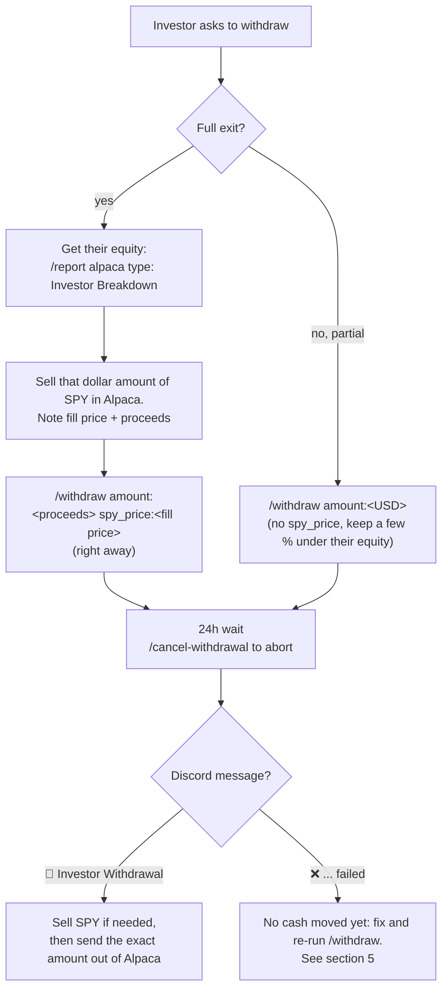

# Investor Deposits & Withdrawals Runbook

How to move an investor's cash into or out of the Alpaca hedge fund without
corrupting the Investor Tracker or the P&L reports.

**The core rule: the ledger changes before the cash does.**

---

## 1. How it works

Every investor owns units in one shared Alpaca account.

```
NAV per unit = live Alpaca equity ÷ all units outstanding
```

- A **deposit** creates new units at the NAV of the moment `/deposit` runs.
- A **withdrawal** redeems units at NAV and pays cash. Cost basis is matched
  FIFO against the investor's deposit lots, for tax.
- **Any cash the ledger doesn't know about is shared by everyone.** Cash that
  arrives early gives existing investors a windfall. Cash that leaves unrecorded
  makes everyone look poorer, and the P&L reports show it as a loss.

### Golden rules

1. **Deposits:** run `/deposit` first, then send the cash.
2. **Withdrawals:** wait for the scheduled withdrawal's success message, then send the cash out.
3. **One money move at a time.** Never `/deposit` while a withdrawal is pending, or in the gap before its cash leaves.
4. **Invest new cash with a dollar-amount (notional) SPY buy.** That is how the P&L reports recognise a deposit.
5. **Use `spy_price` on `/withdraw` only after you've already sold that investor's SPY to cash at that price.**

---

## 2. Depositing

### Every deposit after the first

1. Agree the amount with the investor. **Don't send any cash yet.**
2. In the Private Server, run:
   ```
   /deposit investor:<Name> amount:<USD>
   ```
   Leave `spy_price` empty. It's rejected once units exist.
3. Read the reply. For an existing investor:
   ```
   ✅ Deposit recorded — <Name>
   $<amount> @ NAV $<x>/unit (SPY $<y>)
   ```
   - If it says `🆕 New investor added` for someone who already exists, **the
     name was misspelled**. Stop, and get the ledger fixed before any cash moves.
     There is no undo command for a deposit.
4. Send the cash to Alpaca.
5. Once the cash lands, buy SPY in Alpaca **by dollar amount (notional)** for the
   full deposit, within 1–2 trading days of the cash landing.
   - **Not by share quantity.** The P&L reports detect deposits by looking for
     dollar-amount buys. A share-quantity buy makes the deposit show up as a fake gain.
   - Buying SPY with cash that's already in the account doesn't change equity,
     so it never shifts anyone's units.
6. Check your work ([section 4](#4-checking-your-work)).

### The very first deposit (the fund has no units yet)

Same steps, but you may add `spy_price:<price>` in step 2. With no units
outstanding there's no NAV yet, so the first units are priced at SPY. This is the
**only** time `spy_price` is accepted on `/deposit`.

---

## 3. Withdrawing

Every withdrawal waits **24 hours** after `/withdraw` before it executes. That
window lets you cancel a mistake or a request made from a compromised account.

### Pick the method

| Situation | `/withdraw` with | What gets paid |
|---|---|---|
| **Full exit**, or you already sold the investor's SPY to cash | `spy_price:<sale price>` (**locked**) | Exactly `amount`. The units are frozen when you run the command, so market moves during the 24h don't matter. |
| **Partial**, and the investor's money stays in SPY | no `spy_price` (**unlocked**) | Exactly `amount`. The units are re-priced at live NAV when it executes. It fails if the pool drops enough to put `amount` above the investor's share. |



### Full exit (locked)

1. Get the investor's current value:
   ```
   /report alpaca type: Investor Breakdown
   ```
2. In Alpaca, **sell that dollar amount of SPY**. Note the **fill price** and the
   **proceeds**.
3. **Right away** (within minutes, while the account is unchanged), run:
   ```
   /withdraw investor:<Name> amount:<proceeds> spy_price:<fill price>
   ```
   The reply shows the request ID and `(SPY locked at $<price>)`:
   ```
   ⏳ Withdrawal Scheduled — <Name>
   $<amount> (SPY locked at $<price>) will be processed at <time>.
   Run /cancel-withdrawal id=wd-xxxxxxxx to cancel.
   ```
   If `amount` is within a cent of everything the investor holds, **all** their
   units are redeemed and no dust is left behind.
4. Wait 24 hours. Leave the cash sitting in Alpaca and **run no `/deposit`**.
   - To abort: `/cancel-withdrawal id:<wd-id>`
   - To see what's queued: `/pending-withdrawals`
5. When it executes, Discord posts `💸 Investor Withdrawal — <Name>` with the
   proceeds, FIFO tax lots and a tax estimate.
6. **Only now**, send the exact amount out of Alpaca to the investor. Do it the same day.

### Partial withdrawal (unlocked)

1. Check the investor's value (`/report alpaca type: Investor Breakdown`). Keep
   the request **a few percent under** it, so a market dip during the 24h can't
   push it over the cap.
2. Run:
   ```
   /withdraw investor:<Name> amount:<USD>
   ```
3. Wait 24 hours. Run no `/deposit` in this window.
4. When `💸 Investor Withdrawal — <Name>` posts, sell that dollar amount of SPY
   if the cash isn't already there, then send the exact amount out of Alpaca. Same day.

---

## 4. Checking your work

| Check | How | Correct result |
|---|---|---|
| Deposit priced sensibly | `/deposit` reply | `NAV $<x>/unit` is close to the NAV in the last Investor Breakdown |
| Ledger matches the account | `/report alpaca type: Investor Breakdown` | The investors' equity adds up to the Alpaca account equity |
| Nothing stuck in the queue | `/pending-withdrawals` | `No pending withdrawals.` once everything has executed |
| P&L not polluted | Next 4 PM ET daily P&L | A move roughly the size of SPY's, not a jump the size of the cash moved |

---

## 5. When something goes wrong

| Symptom | Cause | Fix |
|---|---|---|
| `❌ Scheduled withdrawal ... failed: Withdrawal $X exceeds available equity $Y` | Unlocked: the pool fell during the 24h. Locked: more units than the investor holds. | **If no cash has left Alpaca:** re-run `/withdraw` with a lower amount, or use the locked method. **If cash already left:** use the ledger repair below. |
| Cash left Alpaca but the ledger never recorded it | Withdrawal failed or was skipped | Ledger repair, below |
| Daily P&L shows a gain or loss about the size of a cash move | Withdrawal not in the ledger, or a deposit invested by share quantity | Fix the ledger. Reports from then on are correct; past Discord messages are not edited. |
| Wrong name or amount on `/withdraw` | Typo | `/cancel-withdrawal id:<wd-id>` within the 24h, then re-run |
| Wrong name or amount on `/deposit` | Typo (a misspelled name creates a new investor) | No undo command. **Don't send cash.** Get the ledger fixed manually first. |
| `❌ spy_price override is only allowed for the first deposit` | `spy_price` passed on a later deposit | Re-run without `spy_price` |
| `❌ Could not fetch SPY price` / `Could not fetch account equity` | Market data hiccup | Retry in a minute |

### Ledger repair: cash already left, ledger not updated

Run this in the **Render Shell** from the project root. **Each command goes on one
line**, with `--apply` on the same line as the rest.

1. Dry run, which writes nothing:
   ```
   python -m scripts.record_manual_withdrawal --investor <Name> --amount <USD> --exit-spy <price> --date <YYYY-MM-DD> --all-units
   ```
   Use `--units <N>` instead of `--all-units` for a partial redemption.
2. Check the output: units redeemed, proceeds, FIFO cost basis, and any
   `remove pending` lines. Confirm that every pending ID listed is a stale or
   duplicate request, **not a separate real withdrawal**.
3. Apply it, on the same line:
   ```
   python -m scripts.record_manual_withdrawal --investor <Name> --amount <USD> --exit-spy <price> --date <YYYY-MM-DD> --all-units --apply
   ```
   Expect `✅ Recorded.` plus a backup line with `'ok': True`.
4. Run `/pending-withdrawals` in Discord. It should show `No pending withdrawals.`

The script refuses to run if the investor holds no units, so running it twice
can't double-record.

---

## 6. Quick reference

| Command | Use |
|---|---|
| `/deposit investor amount [spy_price]` | Record a deposit **before** the cash moves. `spy_price` only on the very first deposit. |
| `/withdraw investor amount [spy_price]` | Schedule a withdrawal 24h out. `spy_price` = lock, after selling to cash. |
| `/cancel-withdrawal id` | Cancel a pending withdrawal during the 24h |
| `/pending-withdrawals` | List queued withdrawals |
| `/report alpaca type: Investor Breakdown` | Each investor's equity, P&L and share |
| `python -m scripts.record_manual_withdrawal ...` | Render Shell: record a withdrawal whose cash already left |

### Pre-flight checklist

- [ ] No withdrawal is pending (`/pending-withdrawals`)
- [ ] Investor name spelled exactly as in the Investor Breakdown
- [ ] Deposit: `/deposit` runs **before** the cash is sent
- [ ] Deposit: SPY bought **by dollar amount**
- [ ] Withdrawal: cash sent out **after** the `💸 Investor Withdrawal` message, same day
- [ ] Full exit: SPY sold first, then `/withdraw` with `spy_price` right away
